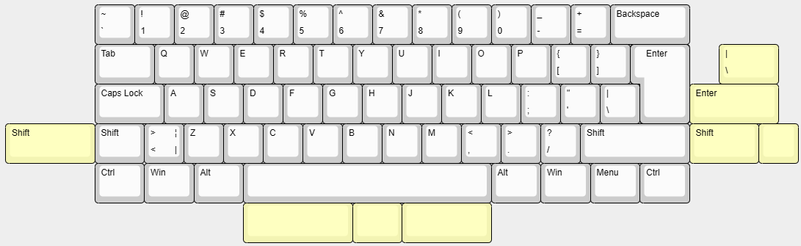

# Slothie60

## 60% ISO/ANSI keyboard

- GH60-Compatible
- Underglow
- QMK/VIAL compatible

## Supports:
  - ISO or ANSI-layout
  - 1.25U or 2.25U Left Shift
  - 1.75U or 2.75U Right Shift
  - 6.25U or 2.75U/1.25U/2.25U Space bar 

ORDERING AT YOUR OWN RESPONSIBILITY! While i have confirmed that this works, order at your own discretion.

Version 2a is a work in progress, 1b is the finished one so if you want to get one, pick that.
KiCad folder includes all the project files, feel free to modify to your own liking. 
Production folder includes all the needed files for ordering these. Zip has all the gerbers, BOM and POS files are needed if you order it assembled.
Firmware-folder has all the files needed for you to either modify and compile yourself, or you can just download the binary and flash it in QMK Toolbox.

Keyboard made under CERN-OHL-W v2 license.
